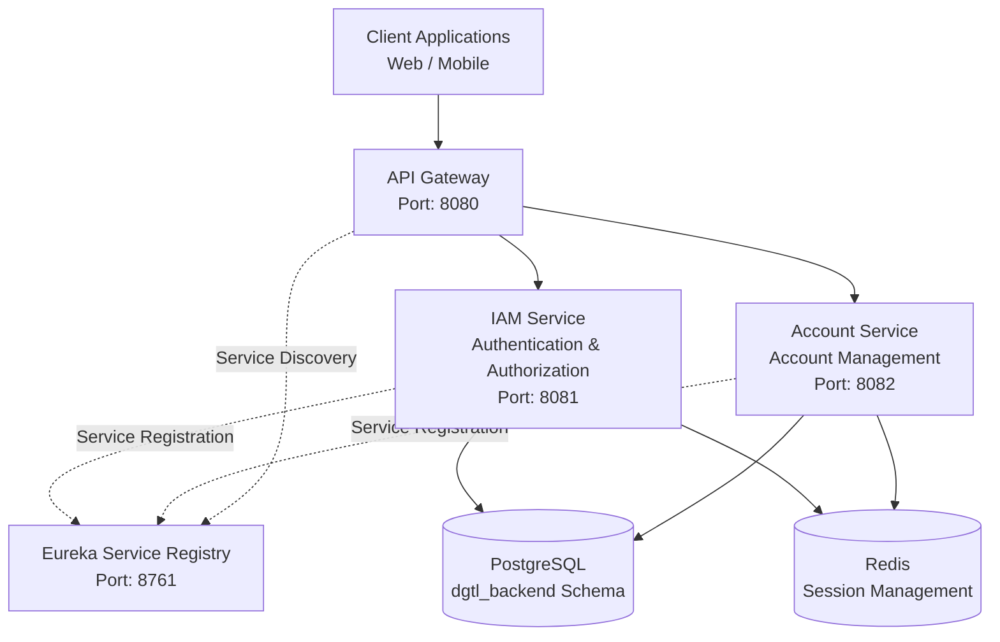

# Java Spring Boot Microservices Architecture

A scalable and modular banking backend architecture built with **Java, Spring Boot, Spring Cloud, PostgreSQL, Redis, and Docker**. The system follows a microservices architecture, separating business capabilities into independent services to improve maintainability, scalability, and deployment flexibility.

## 1. Architecture Overview

The architecture uses an API Gateway as the single entry point for client applications. Eureka Service Registry provides service discovery, allowing microservices to communicate without hardcoding service locations.

### High-Level Architecture



## 2. Technology Stack

| Technology | Purpose |
|---|---|
| Java 17 | Programming Language |
| Spring Boot | Backend Application Framework |
| Spring Cloud Gateway | API Routing and Gateway |
| Netflix Eureka | Service Discovery and Registry |
| Spring Security | Authentication and Authorization |
| OAuth2 / JWT | Token-Based Security |
| Spring Data JPA | Database Access |
| PostgreSQL | Relational Database |
| Redis | Session and Temporary Data Management |
| Apache Kafka | Event-Driven Communication |
| Gradle | Build and Dependency Management |
| Docker | Containerization |

## 3. Microservices

### API Gateway
- Provides a single entry point for client applications.
- Routes requests to the appropriate microservices.
- Supports service discovery through Eureka.
- Integrates with Spring Security for centralized security enforcement.

### Service Registry
- Uses Netflix Eureka for service registration and discovery.
- Maintains registered service instances.
- Enables dynamic service communication.
- Supports service availability and load balancing.

### IAM Service
- Manages user authentication and authorization.
- Supports username and password authentication.
- Implements OAuth2 / JWT-based authentication.
- Manages user accounts and roles.
- Handles access control.

### Account Service
- Manages customer bank accounts.
- Supports account opening validation and confirmation.
- Generates account numbers.
- Manages account information and status.
- Uses Redis for temporary session management.

## 4. Infrastructure

### PostgreSQL
- Stores persistent application data.
- Uses the `dgtl_backend` schema.
- Stores IAM users, roles, customers, accounts, and transaction records.
- Each microservice manages its own business logic and data access.

### Redis
- Provides temporary session storage.
- Supports session validation and consumption.
- Uses configurable TTL for session expiration.
- Helps manage multi-step banking transactions.

### Apache Kafka
- Supports asynchronous, event-driven communication.
- Enables services to publish and consume business events.
- Helps decouple services and background processing.

## 5. Service Ports

| Service | Port |
|---|---:|
| API Gateway | 8080 |
| Service Registry | 8761 |
| IAM Service | 8081 |
| Account Service | 8082 |
| PostgreSQL | 5432 |
| Redis | 6379 |
| Kafka | 9092 |

## 6. Request Flow

1. Client applications send requests to the API Gateway.
2. The API Gateway identifies the target service based on the request path.
3. Eureka provides the registered service instance information.
4. The Gateway forwards the request to the target microservice.
5. The microservice processes the business logic.
6. The service accesses PostgreSQL or Redis when required.
7. The response is returned through the API Gateway to the client.

## 7. Project Structure

```text
├── api-gateway/
│   └── src/
│
├── service-registry/
│   └── src/
│
├── iam-service/
│   └── src/
│
├── account-service/
│   └── src/
│
├── docker-compose.yml
└── README.md
```

## 8. Getting Started

### Prerequisites

- JDK 17 or above
- Gradle
- PostgreSQL
- Redis
- Apache Kafka (if using event-driven features)
- Docker (optional)

### Startup Order

Start the infrastructure services first:

1. PostgreSQL
2. Redis
3. Kafka (if required)

Then start the Spring Boot applications:

1. Service Registry
2. IAM Service
3. Account Service
4. API Gateway

### Build Application

```bash
./gradlew clean build
```

For Windows:

```powershell
.\gradlew.bat clean build
```

### Run Individual Services

```bash
./gradlew bootRun
```

Run the command from each service directory.

## 9. Service Registry Dashboard

After starting the Service Registry, access the Eureka dashboard:

```text
http://localhost:8761
```

Registered microservices should appear on the dashboard.

## 10. Design Principles

- **Microservices Architecture:** Separates business capabilities into independent services.
- **Service Discovery:** Uses Eureka to dynamically discover service instances.
- **Centralized API Entry Point:** Uses API Gateway for request routing.
- **Stateless Authentication:** Uses JWT-based authentication.
- **Temporary Session Management:** Uses Redis with configurable expiration.
- **Database Management:** Uses PostgreSQL for persistent data storage.
- **Event-Driven Communication:** Uses Kafka for asynchronous processing.
- **Containerization:** Supports Docker-based deployment.

## 11. Future Enhancements

- Centralized API Gateway JWT validation.
- Role-Based Access Control (RBAC).
- Distributed tracing and monitoring.
- Centralized logging.
- Circuit breaker and fault tolerance.
- Docker Compose deployment.
- CI/CD pipeline integration.
- API documentation with OpenAPI / Swagger.

---

**Project:** Java Spring Boot Microservices Architecture  
**Purpose:** Banking Backend Services  
**Architecture:** Microservices  
**Language:** Java  
**Framework:** Spring Boot